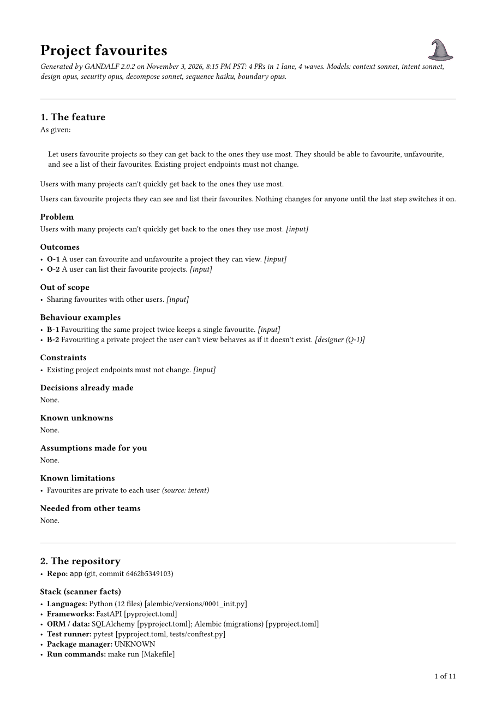
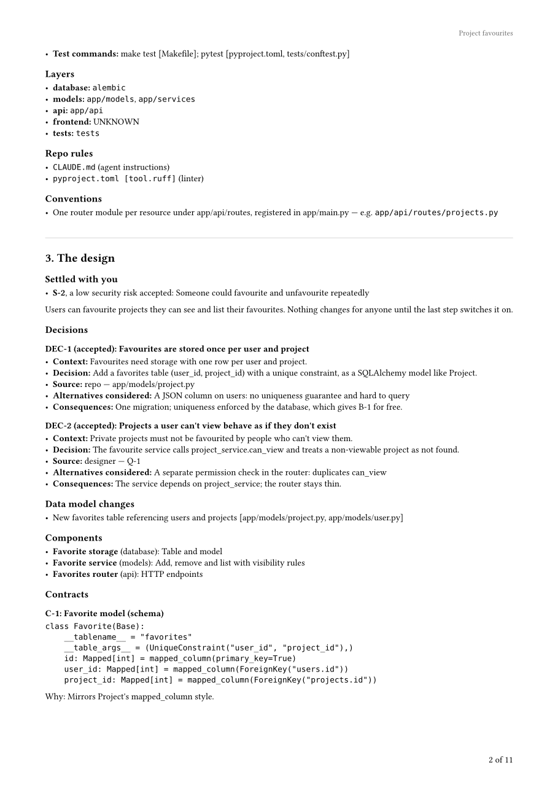

<p align="center"></p>

# GANDALF

**G**rounded **A**rchitecture, **N**arrow **D**iffs, **A**gent-**L**ed **F**low

Give GANDALF a feature idea and a codebase. It reads the repo, asks you what the repo can't
answer, has the design reviewed for security, cuts the work into PRs that land in a safe
order, checks what is true between each PR, and writes one spec: a single document from the
feature as given to a section per PR, each written for a fresh AI coding agent that has
never seen the conversation.

It plans and stops there. No code, no PRs, no agents run, and the target repo is never
touched. How code gets produced in your project comes from the repo's own files, migrations,
codegen, test commands, lint rules, the conventions in your `CLAUDE.md`, quoted rather than
invented.

I built it because I kept watching agents do good work on a feature's first PR and then
drift on the third, once the context that justified the first one was gone. A spec that
carries its own starting state, its exact contracts and its done-when fixes that. Getting
specs to that standard turned out to need a planner with checks of its own. This repo is
that planner.

Every claim about your code cites a file. Anything the repo and your request leave open
becomes a question for you, one at a time, when it changes what gets built or what users
see. Smaller details get decided and listed as assumptions you approve at the checkpoint.
Work lands inert first, then one small PR switches each capability on, so main is never
half-shipped. Whatever one PR hands to another is written out exactly and quoted word for
word on both sides. What code can check about a plan, code checks, and anything wrong goes
back to the model with the reason. The core never calls a model. It hands out prompts and
validates what comes back, so any model can drive it. I drive it from the Claude Code
plugin.

## What a spec looks like

Two pages from a spec for a small feature on a sample repository: the feature as given and
what it became, and the work as a slice map with where each PR lands.

<p align="center">


</p>

## Requirements

Python 3.11 or newer, and git for the target repo. No third-party packages. The plugin
needs Claude Code.

## Install

As a Claude Code plugin, straight from a clone:

```bash
claude --plugin-dir /path/to/gandalf
```

Or as a command-line tool, so `gandalf` is on your PATH:

```bash
uv tool install --editable /path/to/gandalf
```

`pipx install --editable /path/to/gandalf` works too, and so does running
`/path/to/gandalf/bin/gandalf` directly.

## Planning in Claude Code

Open Claude Code in the repo you want to plan for, with the plugin loaded:

```text
/gandalf:plan Let users favourite projects and see a list of their favourites.
```

You can pass a file instead, an RFC or a draft spec, plus any supporting files.

Claude orchestrates. Each stage runs in a fresh, read-only subagent that sees only its own
prompt, so later stages work from what was agreed and never from the whole chat.

1. **Scan.** Code reads the repo's manifests, config and folders. Claude reads the code to
   confirm and deepen what it found, with file citations.
2. **Questions.** One at a time. If you don't know, say so and Claude researches it and
   proposes an answer with evidence. Or say "you decide" and the choice is listed as an
   assumption for you to check at the checkpoint.
3. **Security review.** A separate subagent reviews the design before you see it. A fix that
   changes a contract or a decision sends the design back. A fix against one of your
   decisions comes to you as a question. Every other fix becomes something a PR must make
   true.
4. **Design checkpoint.** You review the decisions with their sources, the contracts and
   what the review asked for, and approve or say what to change. The one fixed stop.
5. **Breakdown and sequencing.** Each security fix lands in the PR that needs it.
6. **Boundary check.** Another subagent checks what's true after each PR merges and before
   the next lands. A gap sends the PRs back to be re-planned. Until this passes, the
   sequence is a draft.
7. **Render.** The spec is written to the plan folder.

A review can send the plan back more than once. The first time it does so on its own. From
the second round each finding comes to you as a choice: rerun, which does what the review
asks and reviews again, or carry, which keeps the plan and hands the finding to the builder
as a requirement.

GANDALF also stops to ask before it adds a dependency, changes existing architecture or
adds anything your request doesn't imply. Infrastructure run outside the app is a question
too, recorded as an external dependency for the team that runs it. It never proposes
restructuring your code. When a feature can't fit without that, it tells you what doesn't
fit, where and why, and asks.

## With any other model

`gandalf run` drives every stage through any command that reads a prompt on stdin and
prints JSON, asking you questions in the terminal:

```bash
gandalf run --repo ~/code/my-app --feature feature.md --model-cmd "claude -p"
```

Models that can't read your repo get excerpts of the relevant files up to a size budget
(`--budget`). Or drive it by hand with any chat model:

```bash
gandalf scan --repo ~/code/my-app --feature feature.md
gandalf prompt --out ~/gandalf-plans/my-app/<feature> --excerpts   # paste this into the model
gandalf submit intent reply.json --out ~/gandalf-plans/my-app/<feature>   # or whichever stage
gandalf render --out ~/gandalf-plans/my-app/<feature>
```

`gandalf prompt` with no stage tells you the next step. Your answers and the approval are
JSON too, and GANDALF shows the shape when it asks.

## Which model runs each stage

Each stage runs on a tier. Out of the box the tiers are Opus, Sonnet and Haiku:

| Stage | Tier |
|---|---|
| Design, security review, boundary check | strong |
| Repo context, intent, breakdown, PR monitor | standard |
| Sequencing | fast |

The reviews find the problems that matter and lose findings on a smaller model, so they
stay strong. Sequencing holds up on the fast tier, since a gap in a sequence is what the
boundary check is there to find. A stage rejected twice in a row runs its next attempt one
tier up, and `escalate_after = 0` turns that off.

Change any of it in `config.toml` in your plans folder (`~/gandalf-plans/`, or
`GANDALF_HOME`). `gandalf config --init` writes a starter file:

```toml
[tiers]
strong = "opus"
standard = "sonnet"
fast = "haiku"

[stages]
design = "standard"             # a tier, or a model name
sequence = "claude-sonnet-5-5"

[retry]
escalate_after = 2
```

When a new model ships you change one line under `[tiers]` and every stage on that tier
moves with it. Each plan keeps the settings it was scanned with, and `gandalf models`
shows or changes them for one plan. With `gandalf run`, put `{model}` in the command and
GANDALF fills it in per stage:

```bash
gandalf run --repo ~/code/my-app --feature feature.md --model-cmd "claude -p --model {model}"
```

## What you get

Plans live outside your repo, in `~/gandalf-plans/<repo>/<feature>/` unless you say
otherwise, so they can't end up in a commit. The plan is one document, `spec.md`:

1. **The feature.** What was asked for, as given, and what it became.
2. **The repository.** Stack, layers, conventions and the repo's own rules, with evidence.
3. **The design.** Decisions with their sources, the data model, the contracts quoted once.
4. **Security.** Every finding and what it changed, and what's true between PRs.
5. **The work.** What to review first, the slice map, the order, lanes and waves, the
   order of operations.
6. **The PRs.** One section each, in build order.
7. **For builders.** The standing rules, stated once, and what to do when reality doesn't
   match.
8. **Record.** Decisions replaced along the way, changes made while building, repairs.

An appendix holds the evidence behind sections 2 to 5. Beside the spec sit `plan.json`, the
same plan as data, `spec.html`, the document as a page with its diagrams, `spec.pdf` when
Typst is installed, and `report/`, the diagrams as SVG. `gandalf render --split` also writes
one self-contained file per PR under `prs/`.

Each PR's section has its goal, starting state, what to read first, the contracts it uses
and exposes by id, every file it changes with existing code to reuse, steps when order
matters, the decisions it applies, breaking changes and how to undo them, the security
fixes it builds in, done when, and out of scope. The header carries the type (inert,
enabling, release, precursor), lane, wave, risk tags, a size band and dependencies.

### Reports and diagrams

Every render draws the build order, where each PR lands in the codebase, and one flow per
PR showing where it meets security-relevant code. Two optional installs add to the report:

```bash
# spec.pdf, typeset by Typst
pip install typst

# the code map: what each PR calls, and what calls it
pip install tree-sitter tree-sitter-python tree-sitter-javascript tree-sitter-typescript \
            tree-sitter-go tree-sitter-rust tree-sitter-ruby tree-sitter-java tree-sitter-php \
            tree-sitter-elixir
```

With the map, GANDALF parses the repo and follows calls both ways from each PR's functions,
marking code the reviews cited, code that matches a pattern (auth checks, raw SQL, shell
calls, unescaped HTML, secrets), and code the plan's own fixes point at. Read the list of
security-relevant code a PR reaches that no review cited first. Nobody has looked at it yet.
The map knows names, not types, and misses code reached through reflection or string-built
routes. Calls between files are followed for Python, JavaScript, TypeScript and Go.

## Building from the plan

Give a fresh agent session in the target repo the spec and the PR to build, in order, with
read access to the plan folder:

```bash
claude --add-dir ~/gandalf-plans/my-app/<feature>
```

Then: "Build PR-03 from spec.md." A PR with steps can be built one step per session.

Section 7 of the spec draws a line. A small fix inside the PR's own files that leaves every
contract, decision and starting-state fact as written is the builder's to make, recorded in
a deviation note handed back with the PR. Anything bigger stops the builder, which writes a
mismatch report. Repair the unbuilt part of the plan with:

```bash
gandalf repair --out <plan folder> --report mismatch.md --merged PR-01,PR-02
```

Merged PRs and the contracts they expose are frozen. The affected stages re-run for the
unbuilt PRs, and nothing is deleted: replaced decisions are marked superseded.

### Watching PRs as they're built

Monitoring is off by default. `gandalf monitor on` for a plan, then check a branch:

```bash
gandalf monitor check PR-03 --branch <branch> --out <plan folder> [--done] [--merged PR-01,PR-02]
```

It reads the branch from your local repo without checking anything out. What gets flagged
is what other PRs rely on: a contract written differently, files outside the spec, planned
files left out, new dependencies or migrations, infrastructure code, anything that looks
like a real secret. A model judges only the flagged signals. A change inside its PR updates
that PR's section. One that reaches other PRs waits for `gandalf monitor approve` or
`reject`.

### Two hard rules

No secrets in the repo. GANDALF never plans a password, key or token anywhere in the
codebase, not even as a local default, and a plan containing anything that looks like a
real secret is rejected.

Application code only. GANDALF never writes infrastructure as code or CI configuration,
even when the repo ships that code. When a feature needs infrastructure from elsewhere, the
design asks you about it and records an external dependency, with a brief for the owning
team in `requests/`. When it's built, `gandalf deliver E-1 --details built.md` records what
was delivered and re-plans the unbuilt work if it differs.

## Folders that aren't git repos

GANDALF works on plain folders with less: no test runs, a content fingerprint instead of a
commit, and ordered change sets instead of PRs. The spec says so at the top.

## Commands

| Command | What it does |
|---|---|
| `gandalf scan` | Scans the target repo without a model and creates the plan folder |
| `gandalf run` | Plans start to finish with a model command, asking you questions in the terminal |
| `gandalf prompt [stage]` | Prints the prompt for the next stage, or a named one. `--excerpts` adds repo files |
| `gandalf submit <stage> FILE` | Validates and stores a stage's output, your answers or your approval |
| `gandalf render` | Writes the spec once every stage is complete and every check passes. `--split` adds one file per PR |
| `gandalf models` | Shows which model runs each stage of a plan. `--set` changes one |
| `gandalf config` | Shows the settings a new plan would get. `--init` writes a starter file |
| `gandalf repair` | Repairs the unbuilt part of a plan after a mismatch report |
| `gandalf deliver E-n` | Records what another team built for an external dependency |
| `gandalf monitor ...` | `on`, `off`, `check`, `prompt`, `submit`, `approve`, `reject`, `history` |

Everything that happens to a plan is logged to `<plan folder>/.state/log.jsonl`, rejected
outputs are kept in `.state/rejected/`, and section 8 of the spec summarises what the checks
caught. You can stop at any point and pick up later with `gandalf prompt --out <plan folder>`.

The plan folder's layout, the spec's sections, `plan.json` with its `schema_version` and
the command line change only in a major version. Prompts and checks keep improving in minor
ones.

## Development

```bash
python3.11 -m venv .venv
.venv/bin/pip install -e .
```

The core is `src/gandalf/`, the prompt templates are `src/gandalf/prompts/`, and the
Claude Code plugin is the repo root: `.claude-plugin/`, `skills/`, `agents/`, `hooks/`
and `bin/`.

## Licence

[Apache License 2.0](LICENSE).
